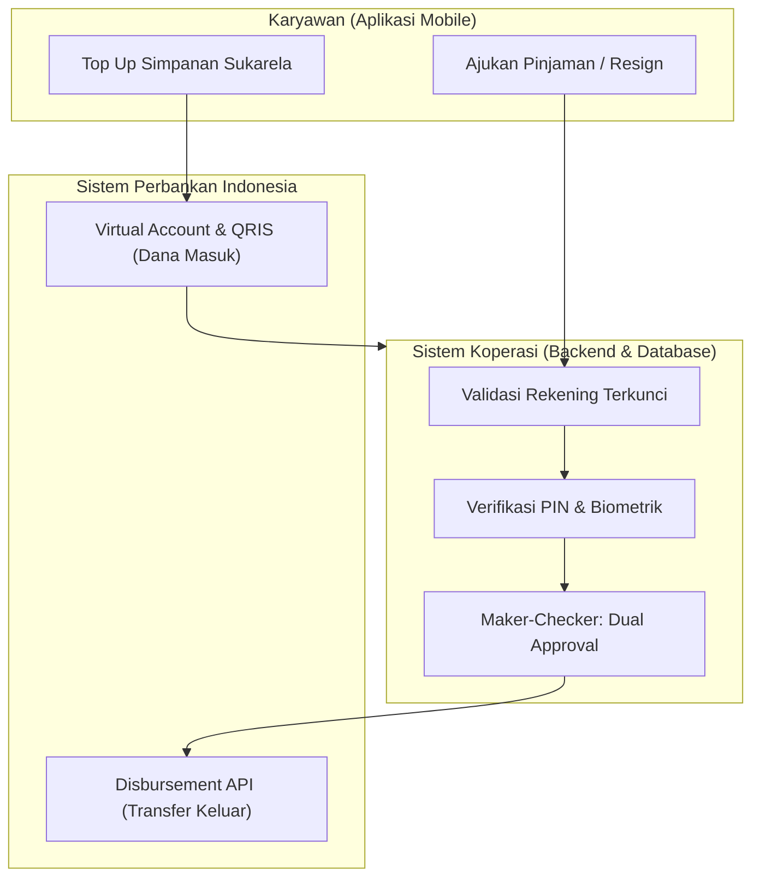
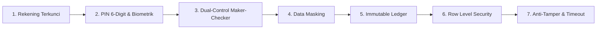

# Panduan Integrasi Bank & 7 Lapis Keamanan Anti-Bobol Koperasi

Dokumen ini disusun untuk menjelaskan cara kerja integrasi perbankan nyata di Koperasi Karyawan (KOPKAR) dan implementasi keamanan tingkat perbankan (*enterprise-grade security*) agar kas dan data anggota tidak dapat dibobol baik dari luar (hacker) maupun dari dalam (orang dalam / fraud internal).

---

## 1. Bagaimana Sistem Perbankan Bekerja di Koperasi?

Di dunia nyata, aplikasi koperasi karyawan terhubung dengan sistem perbankan melalui 2 mekanisme utama:



### A. Uang Masuk ke Koperasi (Inbound / Top-Up)
1. **Potongan Gaji Otomatis (Payroll Deduction):**
   - Dilakukan terpusat melalui kerja sama dengan Divisi HRD/Finance perusahaan.
   - Admin Koperasi mengunduh file rekapitulasi batch bulanan (Rp 125rb untuk bulan ke-1, Rp 25rb untuk bulan ke-2 dst), lalu HRD memotongnya langsung dari sistem payroll (misal: Talenta, SAP, atau bank payroll perusahaan seperti BCA Payroll).
2. **Setoran Sukarela via Virtual Account (VA) & QRIS:**
   - Karyawan memilih bank tujuan (BCA VA, Mandiri VA, BRI VA, atau scan QRIS Koperasi).
   - Pembayaran diverifikasi otomatis secara real-time melalui Payment Gateway (seperti **Midtrans**, **Xendit**, atau **Flip for Business**).

### B. Uang Keluar dari Koperasi (Outbound / Pencairan Resign & Pinjaman)
1. **Disbursement API (Transfer Host-to-Host):**
   - Saat Admin menyetujui klaim resign atau pinjaman, sistem memicu perintah transfer antarbank otomatis melalui API Bank (seperti BCA API Snap / Mandiri Cash Management API / Flip Disbursement API).
   - Uang langsung masuk ke rekening bank pribadi karyawan dalam hitungan detik.

---

## 2. 7 Lapis Keamanan Anti-Bobol (Enterprise Security Architecture)

Koperasi memegang uang ratusan juta hingga miliaran rupiah milik karyawan. Untuk memastikan sistem aman dari peretasan dan kecurangan, aplikasi ini menerapkan **7 Lapis Proteksi**:



---

### LAPIS 1: Rekening Bank Terkunci (Name-Matching Whitelist)
* **Celah Bahaya:** Hacker atau pihak ketiga yang berhasil mengakses akun mencoba mengubah nomor rekening tujuan agar uang ditransfer ke rekening pribadi mereka.
* **Solusi Kami:**
  * Nama pemilik rekening bank **DIKUNCI MATI** sesuai nama resmi karyawan di database HRD/KTP.
  * Sistem API bank memvalidasi nama pemilik rekening sebelum transfer diproses. Jika nama pada rekening tidak cocok dengan nama karyawan, **transaksi otomatis dibatalkan sistem**.

---

### LAPIS 2: PIN Keamanan Transaksi 6-Digit & Biometrik
* **Celah Bahaya:** HP karyawan tertinggal dalam keadaan terbuka, lalu dipinjam atau dioperasikan orang lain tanpa izin.
* **Solusi Kami:**
  * Login aplikasi bisa menggunakan NIK / Biometrik (Fingerprint / Face ID).
  * Namun untuk **setiap aksi finansial** (mencairkan dana, mengubah nomor rekening, mengajukan pinjaman, dan mengajukan resign), **wajib memasukkan 6-digit PIN Keamanan**.
  * Jika salah memasukkan PIN sebanyak 3 kali berturut-turut, akun transaksi akan dibekukan sementara.

---

### LAPIS 3: Sistem Maker-Checker (Dual-Control Approval)
* **Celah Bahaya:** Kecurangan "orang dalam" (misal: staf admin koperasi nakal yang menyetujui pencairan dana fiktif sendirian).
* **Solusi Kami:**
  * Mengadopsi prinsip perbankan **Maker-Checker**:
    * **Maker (Staf Admin):** Menginput dan memverifikasi berkas permohonan resign / pinjaman.
    * **Checker (Ketua Koperasi / Manajer HRD):** Melakukan otorisasi final sebelum dana dicairkan.
  * Pencairan dana di atas limit tertentu (misal: Rp 1.000.000) **tidak bisa dilakukan oleh 1 orang saja**.

---

### LAPIS 4: Data Masking (Penyensoran Data Sensitif)
* **Celah Bahaya:** Orang lain di sebelah karyawan mengintip layar (*shoulder surfing*).
* **Solusi Kami:**
  * Nomor rekening bank selalu disensor parsial (contoh: `8720••••31`).
  * Nomor Induk Kependudukan (NIK) dan PIN disamarkan di antarmuka pengguna.

---

### LAPIS 5: Immutable Double-Entry Ledger (Buku Besar Anti-Edit)
* **Celah Bahaya:** Oknum database administrator mengubah saldo secara langsung (`UPDATE member_balance = 100000000`).
* **Solusi Kami:**
  * Menggunakan standar akuntansi berpasangan (*Double-Entry Bookkeeping*).
  * Nilai saldo **TIDAK PERNAH** disimpan sebagai angka bebas yang bisa diedit.
  * Saldo anggota dihitung dari akumulasi riwayat mutasi di tabel `savings_transactions` yang sifatnya **Append-Only** (hanya bisa ditambah, tidak bisa di-edit atau dihapus).
  * Setiap transaksi memiliki nomor referensi unik dan jejak audit digital (*digital footprint*).

---

### LAPIS 6: Row Level Security (RLS) di Database PostgreSQL
* **Celah Bahaya:** Pengguna yang paham teknis mencoba memanggil API endpoint untuk melihat data atau saldo anggota lain.
* **Solusi Kami:**
  * Di level database (PostgreSQL / Supabase), diterapkan **Row Level Security (RLS)**:
    ```sql
    -- Contoh Kebijakan RLS: Karyawan HANYA bisa membaca datanya sendiri
    CREATE POLICY member_view_own_data ON member_savings_balances
    FOR SELECT USING (auth.uid() = user_id);
    ```
  * Token JWT karyawan A tidak akan pernah bisa membaca baris data milik karyawan B.

---

### LAPIS 7: Session Timeout & Deteksi Perangkat Dimodifikasi
* **Celah Bahaya:** Aplikasi disusupi perangkat lunak pengintai (*malware*) atau dijalankan pada perangkat Android yang telah di-root.
* **Solusi Kami:**
  * **Session Timeout:** Otomatis keluar (*auto-logout*) jika aplikasi tidak digunakan dalam waktu 5 menit.
  * **Audit Log:** Mencatat tanggal, jam, model perangkat, dan alamat IP pada setiap aktivitas login dan transaksi keuangan.

---

## 3. Komponen yang Sudah Diaktifkan di Aplikasi Flutter Anda

1. 🛡️ **Pusat Rekening & PIN (`lib/screens/bank_and_security_screen.dart`):**
   - Dapat diakses langsung dari menu **"Bank & PIN"** di layar beranda.
   - Mengelola rekening bank terverifikasi, ganti PIN 6-digit, toggle biometrik, dan cek log aktivitas login.
2. 🔐 **Security PIN Dialog Widget (`lib/widgets/security_pin_dialog.dart`):**
   - Pop-up keypad PIN interaktif yang otomatis muncul saat karyawan menekan tombol *"Ajukan Klaim Pengembalian Simpanan"* di menu Resign.
3. 👤 **Verifikasi Rekening Terkunci (`lib/models/member_model.dart`):**
   - Menjamin nomor rekening penerima refund dikunci atas nama karyawan yang bersangkutan.
